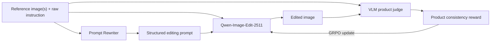

# ReCoEdit: Rewriter-Guided Consistency Alignment for Product Image Editing

<div align="center">

**ReCoEdit helps image editing models change the scene without changing the product.**

<p>
  <a href="https://huggingface.co/spaces/Matteoooo46/ReCoEdit-Demo"></a>
  <a href="https://matteoooo46.github.io/ReCoEdit"></a>
  <a href="https://huggingface.co/Matteoooo46/ReCoEdit-RL"></a>
  <a href="https://huggingface.co/Matteoooo46/ReCoEdit-rewriter"></a>
  <a href="LICENSE"></a>
</p>

</div>

<!--
TODO: Add a qualitative teaser to assets/recoedit_teaser.png, then uncomment:

<p align="center">
  
</p>
-->

## 📖 Abstract

Product image editing must satisfy two goals at the same time: follow the requested edit and preserve the identity of the reference product. In practice, colors shift, logos disappear, patterns change, and shapes deform when the model focuses too heavily on the new scene.

ReCoEdit addresses this problem with two learned components and an inference-time guidance method:

1. **Prompt Rewriter — Qwen3-VL-8B + LoRA.** Given one or more product reference images and a raw instruction, the rewriter produces a structured Chinese editing prompt for Qwen-Image-Edit.
2. **Consistency Alignment — Flow-GRPO + Product Reward.** Qwen-Image-Edit-2511 is optimized with online reinforcement learning. A Qwen3-VL-30B judge compares each edited image with its reference product and provides a normalized consistency reward.
3. **APG Inference.** Adaptive Projected Guidance is applied at inference time to reduce oversaturation and unstable CFG behavior.



## 📢 News

- **August 2026:** The [ReCoEdit online demo](https://huggingface.co/spaces/Matteoooo46/ReCoEdit-Demo) is now available on Hugging Face Spaces.

## 🌐 Online Demo

Try the complete ReCoEdit workflow without setting up a local environment:

### [Launch the ReCoEdit Demo →](https://huggingface.co/spaces/Matteoooo46/ReCoEdit-Demo)

The demo provides an accessible entry point for product-image editing with the released ReCoEdit components.

## 📊 Key Results

The internal product-consistency reward improves substantially during RL training:

| Model stage | Product consistency reward ↑ | Change |
|---|---:|---:|
| SFT initialization | 0.022 | — |
| ReCoEdit RL, peak at epoch 25 | **0.480** | **+0.458 (21.8×)** |

- Base model: [Qwen-Image-Edit-2511](https://huggingface.co/Qwen/Qwen-Image-Edit-2511)
- RL framework: Flow-GRPO with LoRA rank 64
- Reward judge: [Qwen3-VL-30B-A3B-Instruct](https://huggingface.co/Qwen/Qwen3-VL-30B-A3B-Instruct)
- Training configuration: 8 GPUs, bf16, FSDP, activation checkpointing, and optimizer offload

Full epoch-by-epoch reward curve is in [**TRAIN.md**](TRAIN.md).

### Product-region validation (22 products)

On 117 matched frames successfully evaluated in all three configurations, the full trained pipeline improves Seg CLIP-I by **+0.037231 (+5.25%)** and Seg DINO-I by **+0.076935 (+22.30%)** over the base-model CFG pipeline.

| Inference configuration | Seg CLIP-I ↑ | Seg DINO-I ↑ |
|---|---:|---:|
| Base + Original prompt + CFG | 0.709493 | 0.345001 |
| RL + Original prompt + APG | 0.716729 | 0.351560 |
| RL + Trained rewriter + APG | **0.746724** | **0.421937** |

All runs cover 22 products × 6 frames. Valid evaluations are 124/132, 124/132 and 120/132 respectively; failures are excluded, not scored as zero. This compares complete inference configurations: weight and guidance changes are not isolated, and rewriter mode also uses anti-text prompts. These similarity metrics are distinct from the training reward above.

See [**validation protocol, coverage and score files**](EVAL.md) and the [**22-product three-way image viewer**](https://js-ad.a.yximgs.com/bs2/ad-nieuwland-material/qwen_inference/comparison/random22_three_way_20260916/12120fd339b23558/index.html).

> [!NOTE]
> The value above is the internal RL reward, not an independent image-quality or
> generalization metric. See [EVAL.md](EVAL.md) for measured results and caveats,
> and [DATA_PIPELINE.md](DATA_PIPELINE.md) for data construction and audited counts.

### Archived evaluation highlights

- On 117 common successfully segmented frames from the 22-product comparison,
  Base + Original + CFG scores **0.709493 / 0.345001** (Seg CLIP-I / DINO-I),
  versus **0.746724 / 0.421937** for RL + trained rewriter + APG.
- On all 132 frames, SFT + Original + APG improves MUSIQ from **66.833409**
  (Base + Original + APG) to **67.677882**.
- On 99 matched frames from exploratory selected20, trained rewriting improves
  InternVL text-intent/image-completion over untrained rewriting by
  **42.563 / 38.031 points**. This is not a held-out generalization claim.

These compare archived configurations with guidance, prompt-processing and
checkpoint-provenance caveats. Selected20 was outcome-selected and includes
training products. Full denominators, negative results and judge limitations
are in [EVAL.md](EVAL.md); machine-readable aggregates are in
[docs/results/archived_metrics.json](docs/results/archived_metrics.json).

## 🔥 Quick Start

### Option 1: Use the online demo

Open the [Hugging Face Space](https://huggingface.co/spaces/Matteoooo46/ReCoEdit-Demo), upload a product image, enter an editing instruction, and run the edit.

### Option 2: Run locally

#### 1. Clone and create the environment

```bash
git clone https://github.com/Matteoooo46/ReCoEdit.git
cd ReCoEdit

conda create -n recoedit python=3.10 -y
conda activate recoedit

pip install -r requirements.txt
```

The inference implementation also uses [DiffSynth-Studio](https://github.com/modelscope/DiffSynth-Studio) and an APG guidance helper from the upstream Flow-GRPO fork of the pipeline:

```bash
git clone https://github.com/modelscope/DiffSynth-Studio.git third_party/DiffSynth-Studio
pip install -e third_party/DiffSynth-Studio

# APG helper — expose whichever apg_guidance.py you use on PYTHONPATH.
```

#### 2. Run APG inference

The base model and ReCoEdit RL checkpoint are downloaded from Hugging Face on the first run and then reused from the local cache.

```bash
python inference/qwen_image_edit_2511_inference_apg.py \
    --input_image path/to/product.jpg \
    --prompt "把产品放到户外花园场景中" \
    --output outputs/result.png
```

#### 3. Run APG + Prompt Rewriter

```bash
python inference/qwen_image_edit_2511_inference_apg_rewriter.py \
    --input_image path/to/product.jpg \
    --prompt "把产品放到户外花园场景中" \
    --output outputs/result.png
```

Multiple reference images are supported:

```bash
python inference/qwen_image_edit_2511_inference_apg_rewriter.py \
    --input_image ref1.jpg ref2.jpg \
    --prompt "把产品放到户外花园场景中" \
    --output outputs/result.png
```

## 🤗 Model Zoo

| Component | Base model | Released weights | Role |
|---|---|---|---|
| Image editor | [Qwen-Image-Edit-2511](https://huggingface.co/Qwen/Qwen-Image-Edit-2511) | [ReCoEdit-RL](https://huggingface.co/Matteoooo46/ReCoEdit-RL) | Product-consistent image editing |
| Prompt rewriter | [Qwen3-VL-8B-Instruct](https://huggingface.co/Qwen/Qwen3-VL-8B-Instruct) | [ReCoEdit-rewriter](https://huggingface.co/Matteoooo46/ReCoEdit-rewriter) | Structured editing-prompt generation |
| Reward judge | [Qwen3-VL-30B-A3B-Instruct](https://huggingface.co/Qwen/Qwen3-VL-30B-A3B-Instruct) | — | Product-consistency scoring during RL |

## 🔥 Train & Eval

- **Training** — full three-stage pipeline (rewriter SFT → edit-model SFT → consistency RL), including data format, hyperparameters, and launch commands: [**TRAIN.md**](TRAIN.md).
- **Data construction** — synthesis, captioning, editor/rewriter schemas, audited
  statistics and portable annotation export: [**DATA_PIPELINE.md**](DATA_PIPELINE.md).
- **Evaluation** — archived results, cohort definitions, scoring protocols and
  validity limitations: [**EVAL.md**](EVAL.md).

## 🙏 Acknowledgments

ReCoEdit builds on the following open-source projects and models. **We do not vendor their code into this repository** — you install them separately when training. Please cite them if you use ReCoEdit:

- [Flow-GRPO](https://github.com/yifan123/flow_grpo) — reinforcement learning for flow-matching models (used in stage 3)
- [Qwen-Image](https://github.com/QwenLM/Qwen-Image) — base image-editing model family
- [Qwen3-VL](https://github.com/QwenLM/Qwen3-VL) — prompt rewriter and product-consistency judge
- [LLaMA-Factory](https://github.com/hiyouga/LLaMA-Factory) — prompt-rewriter SFT
- [DiffSynth-Studio](https://github.com/modelscope/DiffSynth-Studio) — image-model training and inference
- [vLLM](https://github.com/vllm-project/vllm) — serves the reward VLM during RL

## ✍️ Citation

If ReCoEdit is useful for your work, please cite the repository:

```bibtex
@software{recoedit2025,
  title  = {ReCoEdit: Rewriter-Guided Consistency Alignment for Product Image Editing},
  author = {Matteoooo46},
  year   = {2026},
  url    = {https://github.com/Matteoooo46/ReCoEdit}
}
```

## 📜 License

This project is released under the [MIT License](LICENSE).
